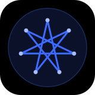

# Staël Djune

**DJSTAR7** · Développeur Full-Stack · Web · Mobile · Backend · Cameroun

Je conçois des applications Web et Mobile utiles, sécurisées et prêtes pour la production.

VISION • DISCIPLINE • IMPACT

## Produits

<table>
  <tr>
    <td width="50%" valign="top">
      
      <h3>KPay</h3>
      FINTECH
      
Paiements, transferts et tontines intégrés au Mobile Money.

      
Next.js · NestJS · Prisma · PostgreSQL · Redis

      
<b>400+</b> utilisateurs actifs · <b>23+</b> pays 
      <a href="https://github.com/Djstar7/kpay-php-sdk">SDK PHP / Laravel public →</a>

    </td>
    <td width="50%" valign="top">
      
      <h3>FormCam</h3>
      EDTECH · SAAS
      
Formations en ligne, formateurs, partenaires et abonnements.

      
Laravel 12 · Vue 3 · Inertia.js 2 · Tailwind CSS

      
<b>150+</b> utilisateurs · projet fondé

    </td>
  </tr>
  <tr>
    <td width="50%" valign="top">
      
      <h3>Estuaire Emploi</h3>
      MOBILE
      
Mise en relation et accès aux offres d'emploi, en temps réel.

      
Flutter · Laravel · temps réel

      
<b>1 750+</b> utilisateurs

    </td>
    <td width="50%" valign="top">
      
      <h3>DSIE</h3>
      INGÉNIERIE
      
Environnement d'ingénierie bâti sur des standards communs.

      
DSIE Engineering Standard (DES)

      
Qualité · Sécurité · Tests · Gouvernance Git

    </td>
  </tr>
</table>

## Stack technique

| Domaine | Technologies |
| :-- | :-- |
| **Backend** | PHP 8.2+ / Laravel 12 · Node.js / NestJS · TypeScript |
| **Interfaces** | REST · WebSockets · gRPC · Webhooks · Sanctum · Spatie Permission |
| **Frontend** | Vue 3 · Nuxt · React · Next.js · Inertia.js · Tailwind CSS |
| **Mobile** | Flutter · Dart · GetX |
| **Données** | PostgreSQL · MySQL · MongoDB · Redis · Prisma |
| **DevOps** | Linux · Docker · Compose · Nginx · GitLab CI/CD · VPS |
| **Paiements** | Orange Money · MTN MoMo · Stripe · CinetPay · NotchPay · FreemoPay |
| *En cours* | *Go · IA appliquée : LLM, tool calling, agents, RAG* |

## Méthode

**Comprendre → Concevoir → Développer → Tester → Déployer → Faire évoluer ↻**

Security by Design · Séparation des responsabilités · Validation stricte des entrées · Transactions maîtrisées · Tests automatisés

## Activité GitHub

<!-- activity:start -->
**28** dépôts publics originaux · **8** langages principaux

| Langage principal | Dépôts | Répartition |
| :-- | --: | :-- |
| HTML | 4 | `███████████░░░░░░░░░` |
| PHP | 4 | `███████████░░░░░░░░░` |
| JavaScript | 3 | `█████████░░░░░░░░░░░` |
| TypeScript | 3 | `█████████░░░░░░░░░░░` |
| Vue | 3 | `█████████░░░░░░░░░░░` |
| Python | 2 | `██████░░░░░░░░░░░░░░` |
| Astro | 1 | `███░░░░░░░░░░░░░░░░░` |
| CSS | 1 | `███░░░░░░░░░░░░░░░░░` |
| Non classé | 7 | `████████████████████` |

Snapshot du 2026-11-11 UTC · forks exclus · un langage principal par dépôt, pas un niveau de maîtrise · [définitions](assets/generated/activity.md) · [tous les dépôts](https://github.com/Djstar7?tab=repositories)
<!-- activity:end -->

## Contact

[Portfolio](https://portfolio-7b9c1c.gitlab.io) · [GitHub](https://github.com/Djstar7)
