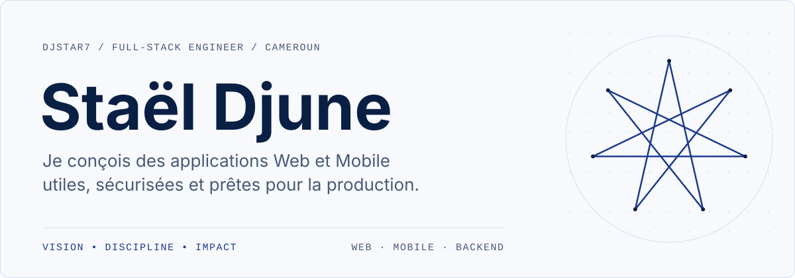
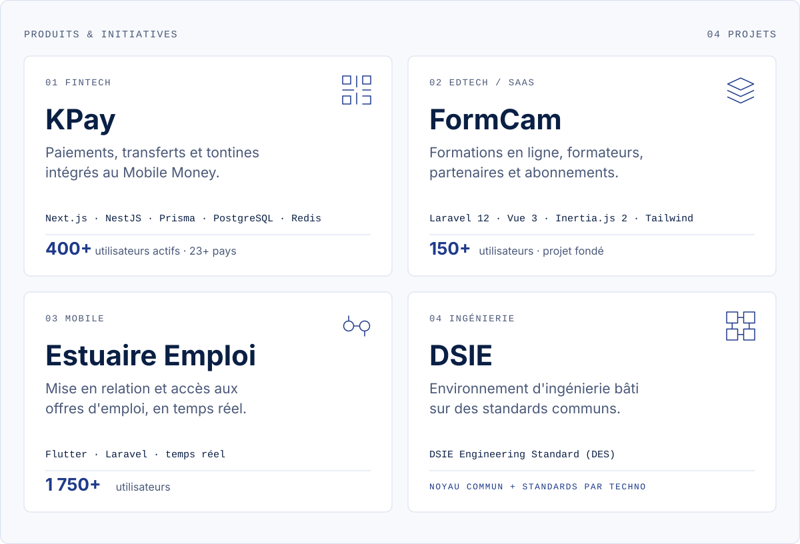
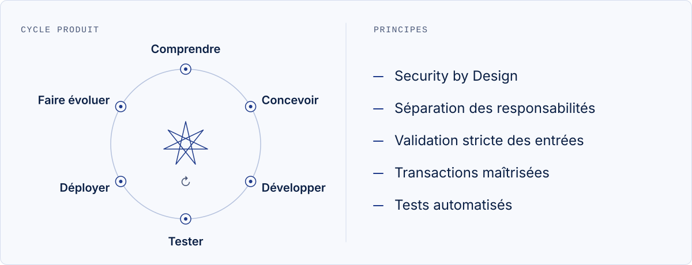
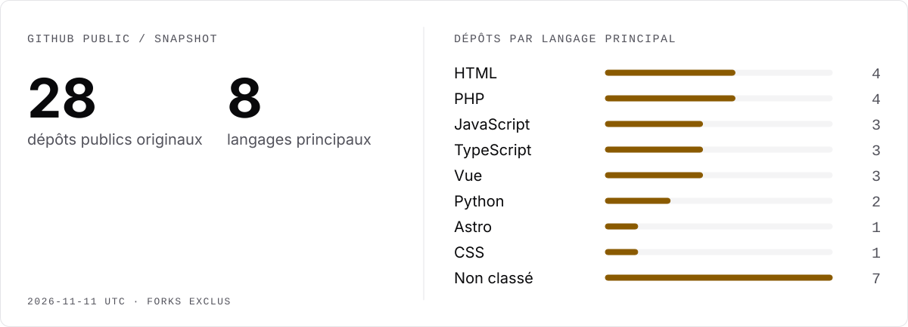

<picture>
  <source media="(max-width: 760px) and (prefers-color-scheme: dark)" srcset="assets/branding/cover-mobile-dark.svg">
  <source media="(max-width: 760px)" srcset="assets/branding/cover-mobile-light.svg">
  <source media="(prefers-color-scheme: dark)" srcset="assets/branding/cover-dark.svg">
  
</picture>

## À propos

Développeur Full-Stack basé au Cameroun, orienté Backend.
Je conçois des applications Web et Mobile utiles, sécurisées et prêtes pour la production.

## Produits

<picture>
  <source media="(max-width: 760px) and (prefers-color-scheme: dark)" srcset="assets/branding/products-mobile-dark.svg">
  <source media="(max-width: 760px)" srcset="assets/branding/products-mobile-light.svg">
  <source media="(prefers-color-scheme: dark)" srcset="assets/branding/products-dark.svg">
  
</picture>

SDK public : **[kpay-php-sdk →](https://github.com/Djstar7/kpay-php-sdk)**

## Stack technique

<picture>
  <source media="(max-width: 760px) and (prefers-color-scheme: dark)" srcset="assets/branding/stack-mobile-dark.svg">
  <source media="(max-width: 760px)" srcset="assets/branding/stack-mobile-light.svg">
  <source media="(prefers-color-scheme: dark)" srcset="assets/branding/stack-dark.svg">
  
</picture>

## Méthode

<picture>
  <source media="(max-width: 760px) and (prefers-color-scheme: dark)" srcset="assets/branding/method-mobile-dark.svg">
  <source media="(max-width: 760px)" srcset="assets/branding/method-mobile-light.svg">
  <source media="(prefers-color-scheme: dark)" srcset="assets/branding/method-dark.svg">
  
</picture>

## Activité GitHub

<a href="assets/generated/activity.md">
  <picture>
    <source media="(max-width: 760px) and (prefers-color-scheme: dark)" srcset="assets/generated/activity-mobile-dark.svg">
    <source media="(max-width: 760px)" srcset="assets/generated/activity-mobile-light.svg">
    <source media="(prefers-color-scheme: dark)" srcset="assets/generated/activity-dark.svg">
    
  </picture>
</a>

[Détail et définitions](assets/generated/activity.md) · [Tous les dépôts](https://github.com/Djstar7?tab=repositories)

## Contact

[Portfolio](https://portfolio-7b9c1c.gitlab.io) · [GitHub](https://github.com/Djstar7)

VISION • DISCIPLINE • IMPACT
