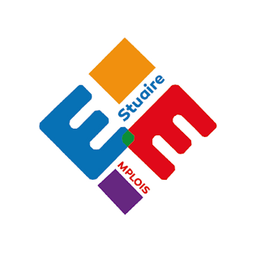
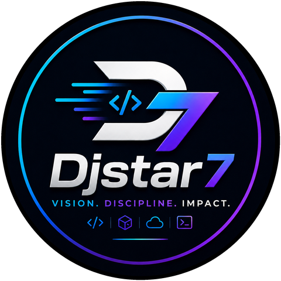

<div align="center">


</div>

## À propos

```ts
const djstar7 = {
  name:     "Staël Djune",
  role:     "Développeur Full-Stack · Web · Mobile · Backend",
  location: "Cameroun",
  focus:    ["Backend", "FinTech & paiements", "Architecture logicielle"],
  learning: ["Go", "DevOps", "IA appliquée : agents, RAG"],
  method:   "Comprendre → Concevoir → Développer → Tester → Déployer → Faire évoluer",
};
```

## Produits

<table>
  <tr>
    <td width="50%" valign="top">
      <a href="https://kpay.site/"></a>
      <h3><a href="https://kpay.site/">KPay</a></h3>
      <sub>FINTECH</sub>
      <p>Paiements, transferts et tontines intégrés au Mobile Money.</p>
      <p><sub>Next.js · NestJS · Prisma · PostgreSQL · Redis</sub></p>
      <p><b>400+</b> utilisateurs actifs · <b>23+</b> pays<br><a href="https://kpay.site/"><b>kpay.site →</b></a> · <a href="https://github.com/Djstar7/kpay-php-sdk">SDK PHP / Laravel →</a></p>
    </td>
    <td width="50%" valign="top">
      <a href="https://formcamer.com/"></a>
      <h3><a href="https://formcamer.com/">FormCam</a></h3>
      <sub>EDTECH · SAAS</sub>
      <p>Formations en ligne, formateurs, partenaires et abonnements.</p>
      <p><sub>Laravel 12 · Vue 3 · Inertia.js 2 · Tailwind CSS</sub></p>
      <p><b>150+</b> utilisateurs · projet fondé<br><a href="https://formcamer.com/"><b>formcamer.com →</b></a></p>
    </td>
  </tr>
  <tr>
    <td width="50%" valign="top">
      <a href="https://play.google.com/store/apps/details?id=com.insam.estuaire_emploie"></a>
      <h3><a href="https://play.google.com/store/apps/details?id=com.insam.estuaire_emploie">Estuaire Emploi</a></h3>
      <sub>MOBILE</sub>
      <p>Mise en relation et accès aux offres d'emploi, en temps réel.</p>
      <p><sub>Flutter · Laravel · temps réel</sub></p>
      <p><b>1 750+</b> utilisateurs<br><a href="https://play.google.com/store/apps/details?id=com.insam.estuaire_emploie"><b>Télécharger sur Google Play →</b></a></p>
    </td>
    <td width="50%" valign="top">
      <a href="https://github.com/dsietech"></a>
      <h3><a href="https://github.com/dsietech">DSIE</a></h3>
      <sub>INGÉNIERIE</sub>
      <p>Environnement d'ingénierie bâti sur des standards communs.</p>
      <p><sub>DSIE Engineering Standard (DES)</sub></p>
      <p>Qualité · Sécurité · Tests · Gouvernance Git<br><a href="https://github.com/dsietech"><b>github.com/dsietech →</b></a></p>
    </td>
  </tr>
</table>

## Stack technique

<table>
  <tr><td><b>Backend</b></td><td></td></tr>
  <tr><td><b>Frontend</b></td><td></td></tr>
  <tr><td><b>Mobile</b></td><td></td></tr>
  <tr><td><b>Données</b></td><td></td></tr>
  <tr><td><b>DevOps</b></td><td></td></tr>
  <tr><td><b>Paiements</b></td><td>Orange Money · MTN MoMo · Stripe · CinetPay · NotchPay · FreemoPay</td></tr>
  <tr><td><i>En cours</i></td><td> &nbsp;<i>IA appliquée : LLM, tool calling, agents, RAG</i></td></tr>
</table>

## Activité GitHub

<div align="center">


</div>

<!-- activity:start -->
<details>
<summary><b>28</b> dépôts publics originaux · <b>8</b> langages principaux</summary>

| Langage principal | Dépôts | Répartition |
| :-- | --: | :-- |
| HTML | 4 | `███████████░░░░░░░░░` |
| PHP | 4 | `███████████░░░░░░░░░` |
| JavaScript | 3 | `█████████░░░░░░░░░░░` |
| TypeScript | 3 | `█████████░░░░░░░░░░░` |
| Vue | 3 | `█████████░░░░░░░░░░░` |
| Python | 2 | `██████░░░░░░░░░░░░░░` |
| Astro | 1 | `███░░░░░░░░░░░░░░░░░` |
| CSS | 1 | `███░░░░░░░░░░░░░░░░░` |
| Non classé | 7 | `████████████████████` |

<sub>Snapshot du 2026-11-11 UTC · forks exclus · un langage principal par dépôt, pas un niveau de maîtrise · [définitions](assets/generated/activity.md) · [tous les dépôts](https://github.com/Djstar7?tab=repositories)</sub>

</details>
<!-- activity:end -->

## Contact

<div align="center">



<a href="https://www.linkedin.com/in/stael-djune-b34669357/"></a> <a href="https://gitlab.com/Djstar7"></a> <a href="mailto:infodjstar7@gmail.com"></a> <a href="https://portfolio-7b9c1c.gitlab.io"></a> <a href="https://github.com/Djstar7"></a>

</div>


